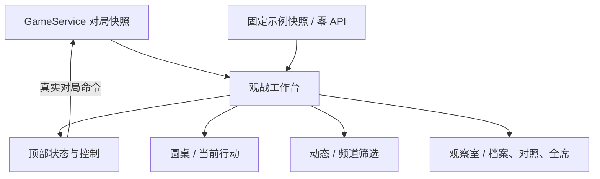

# 硅基狼村 UI 调研与本地改版

调研日期：2026-10-20。重新查看五个项目的前端组件、状态管理、样式和依赖。下述结论来自固定提交的源码，未把 README 截图或功能宣传当作实测结果；本轮未运行这些项目的真实模型对局。

## 现有项目如何搭建 UI

| 项目 | 前端实现 | 页面与交互组织 | 本次吸收的设计 |
| --- | --- | --- | --- |
| AIWolfGame | React 19，TypeScript，Vite，独立 CSS | 开局设置与对局页面分开；对局由 toolbar、RoundTable、PlayerSeat、EventFeed 组成；WebSocket 事件进入观战状态，再驱动席位和事件列表 | 圆桌与事件流作为页面主体；阶段、连接和视角状态集中呈现 |
| 群雄夜宴 / werewolf-game | React 19、TypeScript、Tailwind、Radix UI、Motion；TanStack Query 管理请求，Zustand 管理播放 | PlayerBoard、EventTimeline、PlaybackControls、GameReviewPanel 分工；projectGame 用事件与游标投影画面；中央呈现发言，席位突出当前行动者 | 当前行动居中、控制与内容分层；后续完整回放需要事件游标，不能用样式伪造 |
| WolfMind | Vue 3、Vite、Tailwind；RoomView、AgentCard、GameFeed | 场景由背景层、昼夜元素、席位、气泡叠加；头像显示存活、发言与模型徽记；可查看玩家印象和经验 | 人物状态要清晰；公开发言与私密解释分区，不把所有文本塞进同一个日志框 |
| AutoWerewolf | FastAPI 模板 HTML、原生 JavaScript 和 CSS；另有 Streamlit 入口 | Web 模板把模型、板子及修复参数组织成配置区；game.js 处理控制与事件展示，无须 React 才能拆分布局 | 折叠高级配置；主界面优先展示观战与常用操作 |
| werewolf-multi-agent | Vue 3、TypeScript、Pinia、Tailwind | App 组合 GameBoard、ChatLog、HumanInput、ConnectPanel；阶段改变背景与徽标；连接状态与玩家输入单独处理 | 区分阶段、连接和操作状态；为后续真人加入预留清楚的交互区域 |

源码证据：

- AIWolfGame：[App.tsx](https://github.com/Birchove/AIWolfGame/blob/d974bddc0163529b0552f2c6f3d5ff78134ac4a8/frontend/src/App.tsx)、[RoundTable.tsx](https://github.com/Birchove/AIWolfGame/blob/d974bddc0163529b0552f2c6f3d5ff78134ac4a8/frontend/src/components/RoundTable.tsx)。
- 群雄夜宴：[GamePage.tsx](https://github.com/2623674073/werewolf-game/blob/1d4363491b42cb75dd7526ad61e71168d8122454/frontend/src/pages/GamePage.tsx)、[PlayerBoard.tsx](https://github.com/2623674073/werewolf-game/blob/1d4363491b42cb75dd7526ad61e71168d8122454/frontend/src/components/PlayerBoard.tsx)、[playback.ts](https://github.com/2623674073/werewolf-game/blob/1d4363491b42cb75dd7526ad61e71168d8122454/frontend/src/store/playback.ts)。
- WolfMind：[RoomView.vue](https://github.com/KeLuoJun/WolfMind/blob/850315a02d83608a6a31d22293771d150d8a09d6/frontend/src/components/RoomView.vue)、[GameFeed.vue](https://github.com/KeLuoJun/WolfMind/blob/850315a02d83608a6a31d22293771d150d8a09d6/frontend/src/components/GameFeed.vue)。
- AutoWerewolf：[index.html](https://github.com/Linorman/AutoWerewolf/blob/11f269688041dba9a3f3d11a396adae982a52707/autowerewolf/web/templates/index.html)、[game.js](https://github.com/Linorman/AutoWerewolf/blob/11f269688041dba9a3f3d11a396adae982a52707/autowerewolf/web/static/js/game.js)。
- werewolf-multi-agent：[App.vue](https://github.com/Roger-Lv/werewolf-multi-agent/blob/1c2f02c19f9a0fb1b8b8fb984d9df34d128fd5fc/frontend/src/App.vue)、[GameBoard.vue](https://github.com/Roger-Lv/werewolf-multi-agent/blob/1c2f02c19f9a0fb1b8b8fb984d9df34d128fd5fc/frontend/src/components/GameBoard.vue)。

这些项目共同采用“业务状态 → 展示组件 → 样式与素材”的组织方式。更换框架本身不会自动改善观战体验；先让信息层次、席位状态和操作入口清晰，才能判断哪些交互值得进一步迁移。

## 硅基狼村本次落地

旧版在窄窗口仍并排渲染三个区域，圆桌卡片互相遮挡；六个大号指标、复杂设置与推理频道争夺注意力。改版以圆桌和公开发言为主体，玩家解释下沉到观察室。

- 深色底、低饱和青灰与暖金强调；用统一 SVG 符号、字号、间距和边框替代密集霓虹效果。
- 顶部提供阶段、存活、警长与 Token；常用的开始、暂停、单步、跳过和重置集中到一处。
- 圆桌呈现十二席位，突出当前行动和选中席位；中央显示当前阶段与已完成发言，不伪造流式输出。
- 动态增加全部、玩家、法官频道；玩家观察室提供完整档案、可自主选择双方的对照和十二人概览。
- 模型参数折叠到侧栏；真实 API Key、费用提示和暂停行为保持可见说明。
- 增加固定示例预览。它不实例化 AgentManager，不创建 GameService，不发模型请求；所有示例都明确标注，不进入真实存档与统计。
- 窄窗口将圆桌与动态纵向排列；减少动效偏好得到尊重。模型输出进入 HTML 展示前进行转义。

本次继续使用 Streamlit 和现有 Python 引擎，新增 ui_design.py、ui_preview.py。没有复制上游人物立绘、场景或实现代码；取其组件分工和信息组织方法，视觉与模板在本地重新编写。

## 后续适合投入的方向

需要逐字流式发言、可点击席位卡、稳定保持滚动位置、事件游标回放或多人房间时，再将观战层迁移到 React/Vue，接入结构化 API 与事件订阅。当前页面的频道筛选和焦点对照不等于服务器权限隔离，示例也不代表完整的离线游戏模式。

本次 UI 修改不改变上一轮后台自动推进的语义；关闭页面后的运行与费用行为仍需通过暂停控制。示例预览则完全不调用模型。

## 后续迭代：单一视角、人数条与主题

新增统一的界面投影 `view_projection.py`。单一视角把所选玩家的身份、技能与推理传给展示层；代入狼人时额外显示狼队友身份、狼队名单和夜间作战板，但不显示队友的私密推理或技能状态。其余席位身份为未知，全知事件和非可见夜间行动座位被过滤；完整复盘导出及跨玩家推理在此模式下不呈现。公开发言中的身份宣称仍按公开信息保留。此功能是当前会话的视角切换，不是服务端账号授权，也不修改 AI 本身接收的模型上下文。

人数条在全知模式显示狼人、神职、平民存活与出局四个分段，并列出各类数字；分段宽度按十二席位计算，零人数不会被强行画成非零宽度。单一视角默认只显示存活与出局，阵营剩余数为未知，另提供“显示全知阵营人数”开关。

主题现已迁移到 Streamlit 原生双主题，由右上角 `⋮ → Theme` 的 Light / Dark / System 统一控制；自定义圆桌与人数条使用 `light-dark()` 跟随原生 `color-scheme`。旧的顶部独立下拉及全局文字覆盖已经移除，避免原生深色控件与浅色正文混用。详情见 [主题与 API 稳定性修复](主题与API稳定性修复.md)。

按 [W3C 普通文本对比度要求](https://www.w3.org/WAI/WCAG22/Understanding/contrast-minimum.html)检查常用正文、标签、强调色和主按钮配色至少为 4.5:1，同时在浏览器测量实际按钮前景色及说明文字透明度。该检查覆盖指定颜色组合，不代表整个站点已通过无障碍认证；禁用控件和装饰性边框不纳入此断言。
