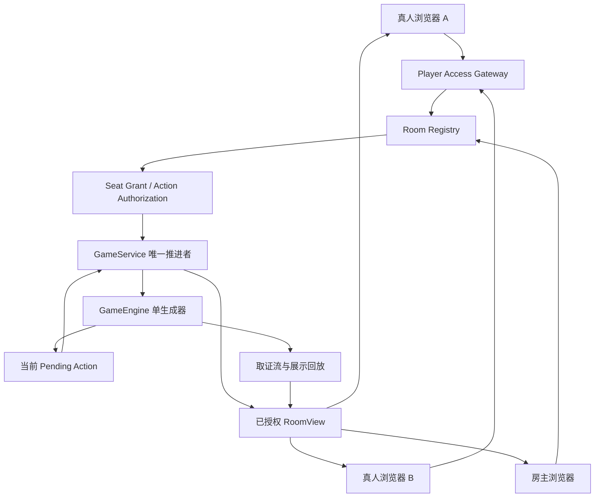

# 多人真人入局架构设计（阶段 6 设计稿）

状态：**仅架构设计，未实施多人入局代码**。本文件是后续实现的约束与验收基线，不代表多人真人对局已经可用。

## 1. 目标与边界

在现有“一个真人席位 + 其余席位由 AI 驱动”的能力上，设计多个独立浏览器分别控制不同真人席位的方案，同时保留现有狼人杀规则引擎、单一推进者、权限投影、观战房间和回放格式。

本阶段只冻结架构与实现顺序，不新增玩家大厅、真人邀请、多人动作 API、聊天频道或线上配置；不开放远程监听，不做真实付费批量模型实验。后续实施必须另开代码 PR，并继续执行代码审查、Python 3.11/3.12 CI 和合并后验证。

### 目标

- 多个真人分别绑定不同座位；每个浏览器只提交自己当前被要求的行动。
- 真人行动严格经过既有规则校验，且不会被 AI 自动代打。
- 多人入局与现有观战授权分离；房间编号、URL 参数和前端隐藏控件都不是权限凭证。
- 保留一个 `GameService`、一个 `GameEngine` 和一个生成器推进权，避免并发推进、重复结算和重复模型请求。
- 明确狼人队伍频道、断线、超时、撤销、终局和进程退出的行为。
- 新设计与既有公开/席位/全知观战、回放、归档及单一真人模式兼容。

### 非目标

- 不在本阶段实现多人真人入局代码。
- 不引入账号系统、支付、跨进程调度、分布式锁或重启后自动恢复生成器。
- 不把真人提交伪装成 AI 响应，也不让房主凭管理权限自动代替某个真人行动。
- 不允许多个真人同时驱动引擎；仅当规则明确存在同时行动窗口时，未来才设计批量提交窗口。
- 不承诺解决模型服务自身延迟；真人等待应与模型请求等待分开诊断。

## 2. 现有实现基线

| 模块 | 当前事实 | 多人扩展约束 |
| --- | --- | --- |
| `engine/game_engine.py` | `human_seat`、`pending_human_action` 和 `_pending_human_context` 均是单席位/单待处理动作状态 | 必须升级为明确的席位绑定与待行动记录；不能简单把一个字段改成列表而保留隐式全局状态 |
| `GameEngine.submit_human_action(action_id, payload)` | 以当前 action ID 验证动作，并由引擎解析/校验 | 必须额外验证服务端绑定的 seat、当前 phase/revision、动作类型及允许目标；客户端不能自报 seat |
| `service/game_service.py` | 由一个服务线程推进生成器；真人输入时暂停，提交后唤醒 | 保留唯一推进者；不能让各浏览器各自持有生成器或直接调用 `next()` |
| `GameService.submit_human_action` | 当前接口不要求玩家授权上下文 | 未来需由独立的玩家动作入口先验证席位授权，再调用服务；不能直接把现有方法暴露给网络入口 |
| `app.py` | 当前真人 UI 围绕一个待处理真人行动构建表单 | 改造时必须按当前登录会话绑定的 seat 显示表单，不根据全局 `human_seat` 推断当前浏览器身份 |
| `service/room_registry.py` | 已有进程内房间、房主管理和只读观战授权 | 观战的 `seat` 权限仍是只读；新增真人控制权限不能复用为观战权限 |
| `service/view_projection.py` / `service/room_view.py` | 已有按视角投影和公开信息边界 | 真人浏览器必须使用自己的席位投影；提交动作所需数据与观看数据分开授权 |
| `storage/replay_recorder.py` / `storage/replay_frames.py` | 取证流与展示回放分开，回放有独立权限投影 | 真人输入必须记录来源、动作类型和阶段关联；不能把私密输入写进公屏事件或公开回放 |
| `tests/test_human_seat.py` | 已覆盖单真人请求、过期 action ID、非法目标及防 AI 代打 | 扩展测试必须覆盖多席位交错、同席位多会话、撤销与跨席位攻击 |

当前实现不能被描述为多人真人对局：单一 `human_seat` 是显式限制，现有共享房间是观战与房主管理，不是多人玩家大厅。

## 3. 建议架构



### 组件职责

1. **Room Registry**：持有房间生命周期、服务引用、房主管理凭证与授权修订号。仅做房间定位、状态与生命周期协调，不把全局引擎对象直接交给浏览器。
2. **Player Access Gateway（拟新增）**：校验玩家凭证、绑定席位、校验 action ID 和 revision，并调用服务端的真人动作提交方法。它不生成动作、不调用模型。
3. **Seat Grant（拟新增）**：每个真人座位单独授权。授权范围至少包括 `room_id`、`game_id`、`seat_id`、`grant_id`、过期时间、撤销状态和授权修订号。
4. **GameService**：继续是唯一推进者、动作提交仲裁者和暂停/恢复协调者。浏览器不得访问生成器或修改引擎字段。
5. **GameEngine**：决定何时需要哪个座位行动、动作是否合法以及规则结算。真人与 AI 的区别是动作来源，不是规则权限。
6. **RoomView / Projection**：向每个玩家返回其可见信息与当前待行动状态。返回数据不含其他真人的授权信息、私密推理或未公开行动。
7. **Recorder / Replay**：记录动作来源和公开发布边界；取证内容与面向观众的公开内容继续分离。

## 4. 数据模型

### 4.1 玩家授权

```text
PlayerGrant
  grant_id
  room_id, game_id
  seat_id                    # 由服务端签发，客户端不可更改
  secret_hash                # 不保存明文邀请码
  created_at, expires_at, revoked_at
  policy_revision
  status: invited | joined | revoked | expired

PlayerSession
  session_id                 # 当前浏览器会话的服务端标识
  grant_id, room_id, game_id, seat_id
  last_seen_at
  status: active | disconnected | expired
```

- 房间编号只负责定位，不是密码。
- 玩家邀请与公开观战、指定席位观战、全知观战分属不同 grant 类型。
- 房主管理凭证不能自动赋予任何玩家座位的提交权；房主若也参与对局，必须另持一个 seat grant。
- 同一 seat 默认只允许一个有效玩家会话。若用户重新加入，必须明确执行旧会话替换，并使旧会话立即失效。
- 玩家密钥仅在签发时显示一次；日志、URL、诊断和导出不得包含明文密钥。

### 4.2 待行动记录

```text
PendingAction
  action_id                  # 随机、不可预测、一次性
  room_id, game_id, phase_id
  seat_id, actor_source      # actor_source 固定为 human 或 ai
  kind                       # speech / vote / skill / wolf_discussion 等
  allowed_targets
  prompt_context_ref         # 服务器内部引用，不发给其他玩家
  created_at, deadline?
  expected_revision
  status: pending | accepted | rejected | expired | canceled
  submitted_payload_hash?
```

- `action_id` 绑定一个确切行动；成功提交后不可复用。
- `expected_revision` 和 `phase_id` 用于拒绝过期表单、重复提交与跨阶段动作。
- `seat_id` 来自服务器端 grant，不信任请求体中的座位号。
- 动作 payload 只包含当前行动所需字段；不能接受客户端传入 `alive`、`roles`、胜者、技能状态、队友名单或任意引擎字段。
- 记录只保存 payload 的必要审计信息或哈希；敏感的完整输入按最小必要原则进入私密取证流，不复制到公屏。

## 5. 动作仲裁与并发策略

### 5.1 第一版采用单待行动窗口

第一版必须保持当前生成器的串行语义：引擎每次只发布一个当前待行动请求。若当前行动属于真人席位，服务暂停推进并等待该席位提交；提交通过后再继续同一生成器。其他真人可以读取各自获准的当前画面，但不能提交别人的行动，也不能提前查看未来提示。

这与狼人夜间多名狼人依次讨论/落刀的当前执行路径兼容，也避免把当前串行规则误改成并行结算。

### 5.2 未来同时行动窗口（暂不实施）

如果某些规则以后确实要求多席位同时决策，应引入独立的 `ActionWindow`：一次性列出允许行动的座位集合、共同 phase ID、截止时间和提交状态。窗口只有在全部合法提交、规则定义的超时策略或房主明确中止后才结算。

不能通过简单地为每个真人创建一个后台线程实现“并行行动”；这会导致生成器重入、状态竞争和重复费用。此窗口不属于当前实现范围。

### 5.3 锁、幂等与提交顺序

- 房间授权校验与动作提交必须具有清晰的线性化边界；撤销与提交并发时，只能有一个先后结果。
- 固定锁顺序：房间/授权锁 → GameService 条件锁 → 引擎状态；引擎或服务后台线程不得反向申请房间锁。
- 通过服务条件锁验证当前 action ID、seat ID、phase ID 和 revision 后，写入动作并唤醒现有推进者。
- 相同 action ID 的重试返回“已处理/已过期”，不能二次结算；不同 action ID 对同一待行动的并发提交只允许一个成功。
- 不在持有全局房间锁时等待浏览器输入、模型请求或执行慢磁盘写入。
- 单次真人提交不触发模型调用；恢复后需要 AI 执行的后续行动仍按原有调度发生，不能因重试重新发起已完成请求。

## 6. 真人与 AI 的行动来源

所有合法行动在进入规则结算前必须有明确的 `actor_source`：`human` 或 `ai`。来源不能由 UI 文案推断，也不能由最终文本猜测。

- 真人行动经当前 `PendingAction` 校验后，使用引擎已有的结构化解析和目标约束，并写入 `actor_source="human"`。
- AI 行动仍由原模型协议解析；如果当前真人座位的历史出现非真人行动，沿用现有 fail-closed 保护并暂停。
- 真人超时、主动跳过和系统错误分别记录为 `manual_skip`、`timeout`、`technical_fallback` 等明确来源；不能把技术失败统计成主动弃票。
- 默认不允许自动将超时真人席位转为 AI。若未来提供房主代管或 AI 接管，必须作为单独的、显式的、可审计的授权策略，不在第一版启用。
- 规则引擎拒绝非法目标时保留原待行动或明确取消，不可静默修正为另一个座位。

## 7. 私密频道与狼人团队协作

多人真人最容易泄露信息的不是普通发言，而是狼人团队讨论、夜间技能和私密结果。

- 公屏、狼人团队频道、单席位私密频道、房主管理信息是四种不同受众，不能复用同一个消息列表后仅靠前端隐藏。
- 狼人团队频道只向当前规则允许获知该信息的狼人席位发布；不向好人、普通观众或已不再拥有相关知识权限的会话发送。
- 团队频道只发布明确的团队讨论文本和已达成的团队决议；不广播其他真人的原始推理、自身技能私密状态、提示词或 API 响应。
- AI 狼人看到的队伍纪要与真人狼人看到的内容应由同一受众规则生成，不能因消息来源是 AI 或真人而绕过权限。
- 当狼人自爆、死亡或失去特定知识权限时，后续团队频道访问按规则重新判定；已发给客户端的内容不能撤回，但新读取不得继续扩散。
- 女巫、预言家、守卫、猎人等角色的技能提交与结果，均由引擎生成当前 seat 的待行动/结果记录；客户端不能自行声明已查验、已用药或已击杀。
- 情侣关系不自动授予读取另一真人座位的全部私密信息。特殊角色的知识边界必须由逐角色测试表明确，而不是靠 UI 条件临时判断。

## 8. 房间生命周期、断线与超时

建议状态机：

```text
created -> setup -> ready -> running
running -> waiting_human -> running
running -> paused -> running
running -> ended
any non-terminal -> failed
ended -> closed
```

- 玩家浏览器断开不推进对局、不自动提交动作。若轮到断线真人，服务保持在 `waiting_human`，并在诊断中显示等待原因和持续时间。
- 第一版默认不自动超时代打。可配置的截止时间到达时，暂停并提示房主；只有游戏规则明确允许的行动才可由房主显式跳过。
- 房主暂停/继续是控制权限，不等于拥有所有玩家席位的提交权限。
- 玩家离开、重新连接、撤销邀请、房主离线和房间结束分别处理；不能因为玩家会话重建而创建新的 GameService 或生成器。
- 进程重启后不自动恢复生成器。房间应标记为不可用/失败，保留部分归档，并告知用户需要重开；不得声称真人动作可在未知状态下安全续跑。
- 结束对局后保留只读观战/回放权限，玩家动作权限默认关闭；终局揭牌不能升级公开观众权限。

## 9. 安全与隐私边界

| 入口 | 必须验证 | 必须拒绝 |
| --- | --- | --- |
| 加入玩家席位 | invite/grant、房间/游戏 ID、过期与撤销状态、席位占用策略 | 只凭 room_id 加入；客户端自选 seat |
| 读取玩家视图 | grant 绑定的 seat、当前 policy revision | 请求其他 seat 或全知视图 |
| 提交行动 | grant、action_id、seat、phase、revision、kind、allowed_targets | 过期动作、重复动作、越权目标、任意状态字段 |
| 读取/导出回放 | 受众与时间点授权 | 原始取证流、未过滤帧、未来事件、其他真人私密信息 |
| 房主管理 | 独立 owner credential 与 expected revision | 把 owner credential 当成玩家席位凭证 |
| 诊断/日志 | 脱敏、最小字段、限定管理视角 | API Key、明文邀请、提示词、原始响应、完整私密记忆 |

对所有拒绝分支都要做服务端测试；控件禁用、URL 参数、客户端 session_state 或 DOM 中是否隐藏按钮不能作为安全证明。

## 10. 与现有观战和回放的兼容策略

- 现有 `InviteGrant(view=public|seat|omniscient)` 保持只读语义；真人玩家 grant 使用独立类型或命名空间，不能让旧席位观众凭升级获得动作权限。
- 真人行动只更新真实引擎与原有取证流；展示帧仍由既有发布边界生成。未经公开的真人动作不会自动成为公屏事件。
- 回放时间轴只显示当时已发布且该受众可见的内容。当前玩家权限不能反向扩大历史席位视角。
- 公开事件、私密技能结果和狼人团队消息使用各自受众标记；不把完整引擎状态作为浏览器 DTO。
- 保存/读档仍为房主操作。普通玩家不能下载完整私密进度存档；如果未来支持玩家端断线恢复，只恢复授权会话，不恢复或复制引擎。
- 归档增加动作来源和玩家授权审计字段时，采用新的 schema 版本和向后兼容读取；旧档不推断谁是真人。

## 11. 实施分期（未来 PR 的验收顺序）

**H0 — 单席位契约重构（不改变用户行为）**
- 把当前单个真人行动包装成 seat-bound pending action，仍只允许一个真人席位。
- 验收：现有单真人测试全部通过；真人请求不会触发模型；过期、重复、非法提交仍拒绝。

**H1 — 多席位授权与静态席位分配**
- 设计并实现独立 PlayerGrant、加入/撤销和 seat-session 绑定；只在测试夹具中创建两个真人席位。
- 验收：同房间两个真人可各自读取自己的授权视图；任一方不能读取/提交另一席位；房间 ID 不授权。

**H2 — 串行真人动作仲裁**
- 同一 GameService 依次等待当前真人席位，使用单待行动窗口；不实现并行窗口。
- 验收：交错的真人/AI 行动顺序一致；双提交只接受一个；无生成器重入、无重复动作、无额外 API 重试。

**H3 — 私密频道与角色矩阵**
- 逐项处理狼人队伍消息与特殊身份知识边界。
- 验收：跨席位隔离测试覆盖好人/狼人/情侣/特殊角色、死亡与权限撤销。

**H4 — 断线、超时与归档**
- 实现显式断线状态、房主提示、审计和只读回放；默认暂停而不是 AI 接管。
- 验收：断线不改变引擎、不产生模型请求；服务重启后失败关闭；旧档保持只读。

每个阶段单独 PR，先审查再运行完整 Python 3.11/3.12 CI，通过后合并。真人入局代码只有在相应阶段开始时才实施；本文件本身不包含实现。

## 12. 最低验收测试矩阵

| 场景 | 预期结果 |
| --- | --- |
| 两个真人席位同时打开页面 | 各自绑定唯一 seat；不会互相覆盖待行动状态 |
| 真人 A 提交真人 B 的 action ID | 拒绝，不改变引擎和 revision |
| 两个会话同时提交同一个 action ID | 最多一个提交成功 |
| 真人刷新页面并重放旧表单 | 显示当前状态；旧 action ID 拒绝 |
| 真人提交非法投票目标/技能目标 | 服务端拒绝；不静默修正目标 |
| 真人等待时观众持续刷新 | 真实推进不受观众读取影响；没有模型请求增量 |
| 真人断线或关闭标签页 | 不自动代打；轮到该席位时保持等待并显示诊断 |
| 房主暂停后玩家提交 | 按服务端状态策略拒绝或排队，不绕过暂停 |
| 房主有管理权限但没有玩家 grant | 可以管理房间，不能替任何席位提交行动 |
| 狼人真人与狼人 AI 讨论 | 只向合法狼人受众发布规定的团队纪要 |
| 好人真人与狼人真人在同一房间 | 好人视图、动作响应、日志和回放均不泄露狼队私密内容 |
| 玩家授权撤销后已开页面继续提交 | 服务器拒绝；页面在下一次读取清空失效视图 |
| 对局终局后玩家 grant 继续提交 | 拒绝；只读回放按原授权策略开放 |
| 进程退出后真人重新打开链接 | 显示房间不可用；不创建新引擎、不自动续局 |
| API 失败与真人弃票并存 | 统计分别归类，技术失票不算主动弃票 |
| 连续 100 次刷新/动作重试 | 不产生重复推进、重复结算或失控内存增长 |

## 13. 运行与费用约束

- 人类提交本身不调用模型 API。真人席位等待期间，不得通过轮询或重渲染重复调用模型。
- AI 席位仍可能按规则调用模型；每个动作与请求 ID 必须可关联，防止浏览器重试导致额外费用。
- 第一版不做自动 AI 接管、不启动后台批量对局、不预跑付费模型。
- 任何真实多人联调须使用隔离测试房间和明确的模型预算；未获预算授权前仅使用假响应和离线夹具。
- 不更改线上部署配置、监听地址、端口、防火墙、网络认证或现有运行进程。

## 14. 决策记录

1. **单推进者**：保留单个 GameService / GameEngine / 生成器；真人是动作来源，不是另一套引擎。
2. **默认串行**：第一版只支持当前一个待行动；同时行动窗口后置。
3. **不自动代打**：断线/超时默认暂停，不把真人席位悄悄交给 AI。
4. **玩家授权与观战授权分离**：只读 seat grant 永远不等于可行动的 player grant。
5. **私密频道显式建模**：狼人团队消息不是公屏日志，也不是所有狼人推理的镜像。
6. **不自动恢复生成器**：进程重启后失败关闭，除非未来另行设计可证明安全的持久化状态机。
7. **阶段 6 只设计**：本次只新增本架构文档与索引，不改动任何真人入局业务代码。
