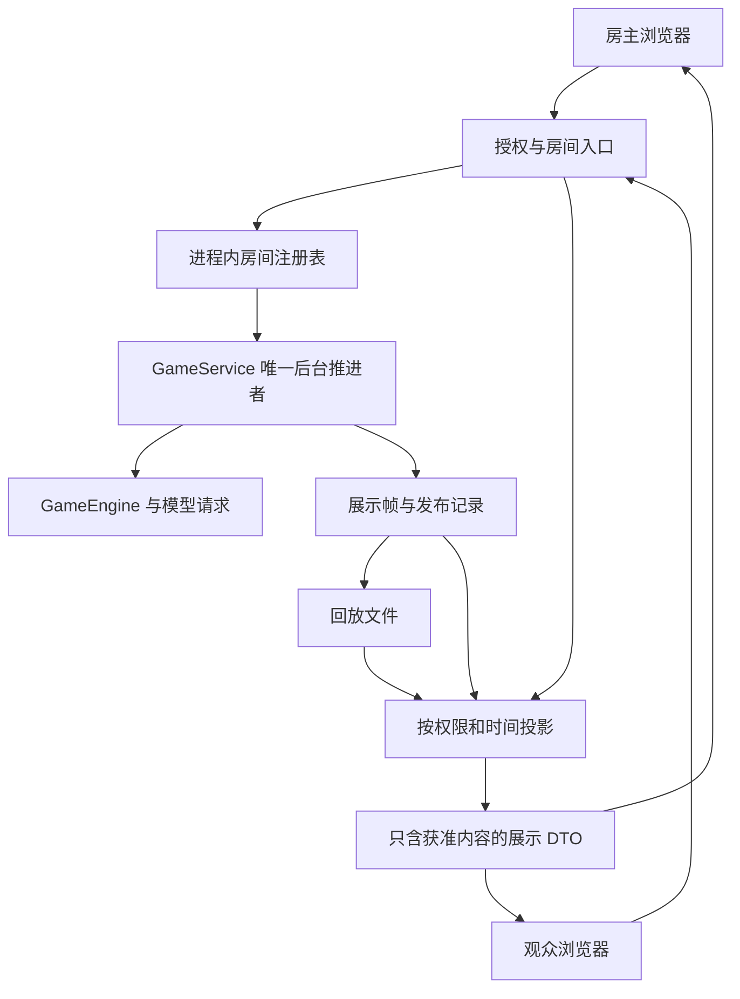

# 多人观战与事件回放技术手册

版本：设计稿 v1.0；日期：2026-10-25。适用目录：`F:\Github\SiliconWolfVillage`。

本文依据当前代码制定实施方案，文中的新增模块、接口和验收项均为待实施设计，不代表功能已经上线。本轮仅撰写手册。已有基线为 139 项离线测试通过；后续新增功能须重新验收。

## 一、范围与交付顺序

近期目标是让多个浏览器安全地观看同一局，并能回看已发生的事件。保留 Python 规则引擎、GameService 后台线程和 Streamlit 1.57 系列。

| 阶段 | 交付 | 明确边界 |
| --- | --- | --- |
| A | 共享房间、邀请与服务端权限、公开/席位/全知观战 | 单进程；不承诺服务重启后恢复房间 |
| B | 已结束对局的时间轴回放与旧归档兼容 | 新局按记录边界还原；旧局按证据降级 |
| C | 进行中对局独立回看、返回直播 | 回放不推进、不暂停真实引擎 |
| D | 公开发言逐字展示的独立方案与原型 | 先做完成校验后的播放效果；真正模型流式输出后置 |

本期不改造生成器恢复、不引入持久化调度或账号体系，不迁移 React/Vue，不实现真人入局、聊天或多进程部署。只补齐多人观战必需的进程内房间索引、授权与展示记录。

阶段 A 需先建好“信息何时可见”的基础，再开放分享；阶段 B、C 复用该基础。模型输入侧统一信息投影另列后续任务，本期不改变 AI 当前收到的上下文。

## 二、当前代码能复用什么

| 位置 | 当前职责 | 改造要求 |
| --- | --- | --- |
| `game_service.py` / `GameService` | 锁内推进、控制、快照、归档 | 保留唯一推进者；由房间层封装控制入口 |
| `app.py` / `init_state`、`install_game`、`sync_game_state` | 每个浏览器会话持有服务与引擎快照 | 会话改持授权上下文和展示 DTO，不让观众进入创建/配置服务流程 |
| `view_projection.py` / `project_view` | 全知与指定席位显示过滤 | 增加纯公开视角、授权约束和时间边界；不能直接作为完整权限系统 |
| `replay_recorder.py` / `GameRecorder` | events、api_calls、memory 三条 JSONL 取证流 | 保留原格式；新增展示回放文件，不把取证流直接发给浏览器 |
| `game_engine.py` / `_compact_state`、`_record_event` | 事件附当前真实局面 | 真实局面不等于观众此刻应知局面，需显式发布信息 |
| `live_feed.py`、`feed_ui.py` | 事件归属、阅读游标、动态容器与跟随 | 增加授权与回放上下文，保留固定槽位和完整渲染正常返回机制 |
| `game_archive.py` | 终局文件、源码指纹、统计 | 登记回放格式与覆盖范围；旧文件保持只读 |
| `session_storage.py` | 按浏览器会话分配临时目录 | 房间固定使用创建时分配的目录，观众不得另建本局目录 |

特别注意：当前 `viewer_seat=None` 表示全知，不表示公开观众；当前投影读取真实 `alive`、技能状态与 wolf war_board，也没有历史时间参数。新接口必须显式区分三种展示模式，避免把“未选席位”误当作全知授权。

现有序号也不同：取证器对三个文件分别维护 `seq`；公屏单独维护 `event_seq`。本期新增 `frame_seq` 作为内部展示帧序号，保留原有序号和关联字段，不改写历史编号。

## 三、整体结构



注册表是单进程共享资源，会话只存 `room_id`、服务器签发的会话凭证、展示模式及回放游标。注册表负责所有权和授权检查，内部持有服务；业务线程继续不访问 Streamlit 会话状态。

实现可使用进程级 `st.cache_resource` 创建注册表，但所有读写须线程安全；不能缓存“当前用户”的授权结果为全局结果。Streamlit 官方说明全局资源会跨用户、会话及 rerun 共享，因此共享服务和共享权限必须分开处理。[资源缓存说明](https://docs.streamlit.io/develop/api-reference/caching-and-state/st.cache_resource)

本机已核对 Streamlit 1.57.0 的实际签名，支持 `scope='global'`；不依据在线文档的较新版本引入未经本机核对的接口。会话状态按浏览器会话隔离，适合存观众自己的游标。[会话状态说明](https://docs.streamlit.io/develop/concepts/architecture/session-state)

首期沿用 1.5 秒轮询。多名观众刷新只读取发布后的帧，不重复复制包含全部玩家记忆的引擎，不调用 `next(gen)`，不触发模型请求。

## 四、房间、邀请与所有权

### 4.1 最小数据结构

```text
RoomRecord
  room_id, game_id, instance_id
  service, archive_directory
  owner_credential_hash
  lifecycle: preparing | live | paused | ended | closed | failed
  revision, policy_revision
  grants, published_frames, replay_status

InviteGrant
  grant_id, room_id, secret_hash
  view: public | seat | omniscient
  seat_id: null | 1..12
  expires_at, revoked_at

ViewerSession
  server_session_id, room_id, grant_id, policy_revision
  mode: live | replay
  opaque_cursor, playback_speed, feed_preferences
```

`room_id` 只负责定位，不是访问密码。邀请密钥采用不可预测的随机值，服务器只保存散列。邀请本身不含控制权限；全知邀请也不能操作游戏。

### 4.2 进入方式

房主创建本局后获得独立的管理凭证，并可生成公开、指定席位或全知邀请。首期建议分享“含房间编号的链接＋单独的邀请码”，邀请码在密码输入框提交；URL 不承载管理密钥或邀请秘密。URL 参数只作房间导航，参数可被用户修改，不能作为可信的权限声明。[URL 参数说明](https://docs.streamlit.io/develop/api-reference/caching-and-state/st.query_params)

服务器验证邀请后，将授权绑定到当前会话。每次读取、导出和控制都检查授权是否仍有效。已撤销或过期的邀请所建立的会话也失效；不得只禁止新连接。重复 URL 参数、无效席位、跨房间凭证统一拒绝。

无账号阶段，凭证持有者即代表对应权限；不能识别现实中的个人，也不能防止受邀者转发邀请码。房主可撤销邀请并重新签发。房主重新进入需要管理凭证，丢失后不靠房间编号恢复控制权；不在本期引入密码找回流程。

### 4.3 生命周期与控制

- 一间房固定对应一局。房主“开始新局”创建新房间，旧邀请不能自动指向新局。
- 观众进入、刷新、退出、浏览器断线均不改变对局运行状态。房主离开也延续当前后台推进语义。
- 对已结束房间仍允许按权限回放；关闭分享与销毁对局为不同操作。
- 注册表不得因普通页面缓存失效而静默替换活跃房间。重载或进程退出导致的房间丢失显示“房间不可用”，不自动创建替代对局。
- 首期设保守的房间和会话容量限制；超限拒绝新增，不清理正在运行的付费对局。已结束房间可显式释放，保留归档文件。
- 房间启动失败须释放候选 manager/服务，不能破坏原房间；浏览器刷新不能重复执行创建命令。

## 五、权限与信息边界

### 5.1 权限矩阵

| 内容/操作 | 公开观众 | 指定席位观众 | 全知观众 | 房主 |
| --- | --- | --- | --- | --- |
| 已公开发言、死讯、票型、警徽 | 可见 | 可见 | 可见 | 可见 |
| 真实身份 | 不额外揭示 | 自己及规则允许知道的身份 | 全部 | 全部 |
| 技能结果、技能余量、自述推理 | 不可见 | 仅该席位当时已获得的信息 | 当时已产生的信息 | 当时已产生的信息 |
| 狼队作战板 | 不可见 | 狼人席位且当时已产生的内容 | 可见 | 可见 |
| 精确阵营存活人数 | 不可见 | 不可见 | 可见 | 可见 |
| 切换到其他身份或全知 | 不可 | 不可 | 可切换为更窄展示 | 可 |
| 开始、暂停、单步、跳过、传音、改模型、读档 | 不可 | 不可 | 不可 | 可 |
| 经授权过滤的展示记录导出 | 可 | 可 | 可 | 可 |
| 完整取证档案、原始 API/记忆、管理诊断 | 不可 | 不可 | 不可 | 可 |
| API Key、邀请码散列、服务器路径 | 不可 | 不可 | 不可 | 不回显密钥；路径仅管理界面按需提供 |

全知观众可查看完整游戏信息，但不因此获得原始请求、服务配置或管理资料。公开身份声明仍作为玩家发言展示，不自动转为可信底牌。终局不会自动把公开或席位邀请升级为全知；要看终局揭牌，需房主另行授权。

席位死亡不扩大权限，不自动获得死后全知。狼人看到队友身份不等于能看队友推理或技能状态。丘比特、情侣等特殊身份必须逐项定义知识来源；不确定的信息先隐藏，再由规则测试证明应公开。

### 5.2 展示 DTO 白名单

建议新增 `RoomView`，只包含房间公开标题、获准的阶段、可见玩家状态、动态、当前观看位置及允许的按钮能力。默认不包含 manager、engine、原始 roles、recorder、磁盘路径、随机种子、完整健康诊断或源代码快照。

观众入口必须在渲染侧边栏与调用 `sync_game_state` 之前完成分流；观众会话不保存完整引擎或管理凭证。下载处理也走同一授权边界，不能给观众直接下载 `final_state.json`、manifest 或原始 JSONL。

房主视角切换仍可保留，但它只是授权范围内的显示选择。后端接收的 `seat_id` 与 view 必须落在凭证允许范围内，不能信任前端隐藏状态、URL 或控件禁用状态。

### 5.3 何时可见

需要分开记录真实发生时间与信息发布时间。例如夜间已结算的死亡在法官宣布前，公开观众仍看到此前已知存活状态；警长竞选中的“死不知情”不因后台数据改变而被提前揭穿。

建议建立 `VisibilityLedger`：保存机械事实及明确的发布记录，记录受众、发布帧和内容。受众包括 public、指定席位集合、omniscient；狼队私密信息记录产生当时的收件席位，不能在回放时用最新狼队集合猜测。

投影读取指定帧以前的发布记录：预言家收到查验结果之后才可见该结果；女巫技能变化只向其本人和全知发布；暗投期间不暴露他人票向，公布票型后才公开。公开阶段标签、行动席位、用量和错误消息也必须经过同样审查，防止从“女巫行动中”等文字反推角色。

圆桌 DTO 应区分“已知存活、已公布出局、状态未知/未更新”，不要直接复用引擎的布尔 alive。未知身份使用中性图标和样式，不通过阵营色、排序、提示文字或无障碍标签泄露。回放内发言、技能与阶段说明均按同一目标帧投影。

## 六、展示记录与回放数据

### 6.1 首期采用发布帧

为了不把规则引擎同时重构成事件溯源系统，新增只用于显示的 `ReplayFrame`。在可观察的状态变化处记录完整的展示状态，回放直接读取相应帧，不重新执行规则、模型或生成器。

内部帧可包含全知、公开及十二个席位的投影结果，也可对相同内容使用内部引用去重。首期优先实现完整投影并测量大小，单帧不重复嵌入全量历史发言；动态与推理记录引用追加写入的展示内容。读取时先选获准视角，再解析引用，绝不把全部视角一起传给客户端。

```text
ReplayFrame（服务器内部格式）
  replay_schema_version = 1
  game_id, frame_seq, recorded_at, trigger
  source_refs: [{stream, seq}]       # 可选取证关联
  display_state: public / seat_views / omniscient
  published_item_refs
  completeness: complete | partial

DisplayItem（服务器内部格式）
  item_id, game_id, published_frame
  audience: public | seats([...]) | omniscient
  kind, actor_seat?, payload
  origin_public_event_seq?          # 公屏来源，可为空
```

这些文件是受信任服务器内部资料，可能包含全部身份与自述推理，不能作为静态资源公开。`replay_schema_version` 独立于现有归档 schema v2，不因新增展示文件重写旧取证流。

### 6.2 记录边界与一致性

拟在服务锁内完成推进与展示帧构建：取本次成功推进后的局面、应用显式发布记录、生成不可变帧，再发布新 revision。对同一受众没有展示变化的 waiting/compress_waiting 不产生可见新帧；纯等待秒数由界面计算。

必须覆盖初始可见状态、阶段改变、合法公开发言、票型公布、死讯公布、警徽转移、公开技能、私密结果送达、暂停/错误与终局。若一次 `next()` 内有多条必须分别呈现的消息，保留消息顺序并归属该帧；首期时间轴精度为发布边界，不宣称还原每条 Python 指令。

展示帧先作为完整 JSON 行追加成功，再发布给共享读者，避免读者得到尚未记录的回放位置。初期可采用锁内有界的单帧写入，记录写入耗时；后续若改为写队列，需另行设计提交顺序和背压，不能直接绕开这项一致性约束。

展示记录写入失败后暂停下一次推进并通知房主，保留内存局面和待写帧；不得重跑已结算动作。失败帧未持久化前，直播可展示带“记录中断”标记的授权内存快照，但不伪造可回放游标。原取证器 `_record_event` 会捕获错误后继续，不能直接沿用其行为来宣称新回放记录完整。

逐行 flush 不等于断电事务保证。读取器只接收完整且 schema 有效的行；半行尾部显示缺口，未知版本拒绝“精确回放”。相同 game_id/frame_seq 内容相同可去重，内容冲突须报错，不能取最后一条掩盖问题。

跨文件采用“内容先写、帧后提交”：先写该帧引用的 DisplayItem，再写包含完整引用清单的 ReplayFrame。只有引用均存在且校验通过的完整帧可回放；未被完整帧引用的尾部内容视为未提交，不单独显示。索引从这些完整帧重建，不从文件行数推断提交进度。

### 6.3 存储位置

新文件建议放在本局已有归档目录：`replay_frames.jsonl`、`replay_items.jsonl`、`replay_manifest.json`。首期仍使用原存储根目录，不迁移所有历史数据；清理临时目录仍可能丢失回放，房主可主动导出。

manifest 记录首末帧、格式版本、覆盖范围、记录缺口及源码指纹。初版不要求 SQLite；结束对局按需建立帧偏移索引，索引是可重建派生文件。缓存限制房间数、帧页数和体积，不能无限缓存所有玩家全文。

## 七、时间轴与直播回看

### 7.1 两个独立游标

服务的真实进度与观众的观看位置完全分开。`live_revision` 表示当前发布版本；观众持 `opaque_cursor`，服务器解析为其受众下的可见帧。进入回看只改本会话游标；返回直播只切到最新可见帧。

内部 `frame_seq` 不直接作为受限观众的连续页码。隐藏事件造成的序号间隔、消息计数和“下一步”按钮不能暴露秘密动作数量；为每个受众生成可见索引或不透明游标。对该受众没有变化的内部帧不占可见时间轴位置。

### 7.2 交互规则

- 顶部明确显示“直播”或“正在回看 第 X 天 / 阶段”，回看期间不把最新胜者、阵营数或当前行动者混进历史画面。
- 时间轴支持上一事件、下一事件、按天/阶段跳转、播放与暂停。播放速度只控制展示节奏，不改变后台推演速度。
- 主回放画面与侧栏展示统计使用同一历史时间；房主当前管理状态若必须保留，独立标为“真实对局控制”，不得与回放统计混淆。
- 直播期间有新内容时，回看位置保持不变，提示新增的获准事件数；点击“返回直播”才追到最新。
- 动态“跟随最新”仅控制当前观看范围内的滚动，不自动退出回放；“顶部”“沉底一次”不改变引擎或时间轴游标。
- feed 容器身份增加授权版本、直播/回放模式及回放目标标识。普通直播追加不能每帧更换容器；主动跳转时清理旧槽位，避免历史节点残留。
- 切换视角、权限变化或房间切换时重新计算可见游标，不能沿用其他视角的隐藏事件位置。

### 7.3 缓存与撤销

任何缓存键至少包括 game_id、受众类别/席位、policy_revision、回放版本和目标位置。原始内部帧可独立共享缓存，但其投影结果不能跨权限复用。

撤销与读取在授权边界内串行判定；撤销生效后的新读取、导出与控制均拒绝。已发送到浏览器的内容无法撤回，页面最多在下一次轮询清空，不承诺消除截图或历史记忆。授权过期时停止播放并清空当前展示，不继续播放本地已排队的敏感帧。

## 八、旧归档兼容

| 可用材料 | 可交付体验 | 不得声称 |
| --- | --- | --- |
| 新版完整发布帧 | 各获准视角按帧回放 | 未记录边界的逐指令重演 |
| 旧 events.jsonl＋终局文件 | 经过白名单转换的事件列表；有证据的公开时间轴；全知可看独立终局页 | 任意历史时刻技能余量、队友知识与真实棋盘的完整重建 |
| 仅 final_state / public_log | 最终摘要及已有发言顺序；标签显示“终局快照” | 把终局身份、死亡和技能状态倒灌到早期画面 |
| 仅过程 JSONL 或缺少终局 | “记录中断”的有限事件浏览 | 正常结束、胜者已定或可恢复运行 |

旧解析器以明确事件类型白名单提取公开内容，丢弃其嵌套真实 state、role、私密响应等字段；不能把所有 `engine_yield.status` 当公开文字。未认识的事件类型不公开。

旧档缺少席位信息获取时间证据时，禁用对应席位的历史私密面板，显示“旧档未记录”。不依靠模型推断，不从最终状态反填。跨文件 timestamp 只作展示辅助，不当作可靠的全局因果顺序；每条取证流保留自己的 seq。

读取仅针对房主明确选定或房间登记的档案，客户端不能传任意文件路径；不提供全站临时目录浏览。原始归档保持只读，兼容转换结果标明来源、缺口与转换器版本。

## 九、接口与模块拆分

建议新增模块名称如下，具体实现时可按复杂度合并，但责任边界不合并。

| 模块 | 责任 |
| --- | --- |
| `room_registry.py` | 房间所有权、服务生命周期、进程内索引 |
| `room_access.py` | 邀请、会话凭证、撤销、服务端操作授权 |
| `visibility.py` | 发布账本、受众规则、按时间筛选 |
| `room_view.py` | 白名单 DTO 与受限错误提示 |
| `replay_frames.py` | 不可变展示帧、写入与完整性状态 |
| `replay_reader.py` | 分页、可见游标、旧档兼容 |
| `spectator_ui.py` | 观众入口、时间轴与授权内导出 |

设计接口示例（进程内函数，不代表首期要开放 HTTP API）：

```text
create_room(owner_session, setup, command_id) -> OwnerReceipt
issue_invite(owner_context, room_id, view, seat_id, expires_at) -> InviteSecret
join_room(viewer_session, room_id, invite_secret) -> AccessContext
read_view(access, cursor=LIVE) -> RoomView
list_timeline(access, page_cursor) -> VisibleTimelinePage
execute_control(owner_context, command_id, expected_revision, command) -> ControlResult
revoke_invite(owner_context, grant_id) -> PolicyRevision
export_view(access, range) -> FilteredExport
```

控制命令在授权后进入既有服务锁；command_id 防止重试重复执行，expected_revision 使过时的跳过/单步请求失败。并发下固定锁顺序为房间授权/状态锁再服务锁；服务线程不得反向申请房间锁，避免死锁。网络请求与磁盘归档不在注册表全局锁内执行。

邀请权限检查、房间绑定和执行不能分离成可被撤销竞态绕过的步骤。新建 API、导出端点或新的 UI 回调均必须复用授权入口，不能绕回原始 service 方法。

## 十、流式发言的后续边界

阶段 D 先提供“已完成发言逐字播放”，使用已经完整校验并正式提交的公开 speech，不改变费用、动作协议和取证事实；允许跳过动画与减少动效。界面明确这是播放效果，不称为模型实时生成。

真正流式输出另行设计：当前请求返回一个 JSON 对象，可能包含 reasoning、speech、技能及目标，不能把原始分片或截断 speech 直接发送给观众。失败重试的内容、迟到响应、取消结果、私密字段均不能进入正式动态。

若未来确实公开未验证草稿，必须接受“已展示文字无法撤回”的限制，定义独立的公开文本通道、发布规则及草稿标识，并测试截断、重试、超时和用量归属。不能通过多发一次模型请求来默认换取流式效果，也不将此改动捆绑进 A—C。

## 十一、实施拆分与验收

### A：权限与共享房间

先新增授权、房间注册表与 DTO 单元测试，再拆分房主/观众 UI；引入公开发布账本并覆盖夜间延迟死讯。最后用两个以上独立浏览器会话连接同一离线模拟局。

验收：只有一个 GameService、一个生成器、一次动作提交；观众刷新不新增 API 请求。公开观众不能通过 URL、会话参数、导出、诊断、控件回调或缓存拿到完整身份；撤销后新读取失败；全知观众也不能控制对局。

### B：终局回放

补展示帧记录、读取器和时间轴，先用确定性模拟局验证，再只读适配旧档。每条转换规则都要有实际字段依据。

验收：同一帧重复读取结果一致；倒放到死讯公布前恢复未知生死状态；查验、药品、警徽、暗投和跨阵营情侣的可见信息不会提前出现。旧档缺字段显示缺失，不猜测。所有回放网络调用数为零。

### C：直播回看

为每个观众引入独立游标和返回直播，控制动态容器身份、跟随与未读计数。

验收：A 观众停在第 1 天，B 观众持续看直播，后台正常推进；A 播放/暂停不改变 B 或引擎。终局后仍可回到终局前且无胜者残留。授权切换和连续 100 帧刷新不出现跨局、跨视角内容。

### 必须覆盖的测试场景

| 场景 | 核心断言 |
| --- | --- |
| 两个房间、不同邀请、同一事件号 | 数据与权限不串房 |
| 公开/席位/全知同时访问 | 浏览器收到的数据各自符合白名单，而非只检查肉眼隐藏 |
| 狼人席位、好人席位、情侣身份 | 合法知识可见，队友推理和未知底牌不泄露 |
| 夜间死亡、竞选延后公布、私密技能 | 真实状态变化不会提前改公开圆桌 |
| 暗投与 PK | 公布前不能从票型或计数推断别人的投票 |
| 邀请过期/撤销、伪造席位、跨房间凭证 | 读取、控制、导出统一拒绝 |
| 并发单步/跳过与重复 command_id | 无重复推进、无跳错玩家、无死锁 |
| 重复/冲突帧、缺帧、半行尾部 | 保守降级，不伪造完整记录 |
| 89→90→91→0→64 条及切局、跳转 | 无旧正文、滚动命令或未读数残留 |
| 直播终局后回看 | 历史页不泄露未来胜者、身份和统计 |
| 观众断开、房主断开 | 不改变既定后台费用语义 |
| 服务退出后再次进入 | 显示不可用，不自动重建/续跑 |

性能验收使用离线模型，建议从 10 个并发观众、1000 条展示记录起步，记录机器环境、帧构建耗时、锁等待、内存及可见延迟。目标为普通操作在约两个轮询周期内可见；这是待测目标，不是现有容量承诺。观众数增加不得线性增加全引擎复制或模型调用。

保留并运行原有完整回归。跨会话权限与 DOM 残留需要独立浏览器验证，不能仅用 AppTest 的可见控件断言替代。测试全程使用假响应、隔离存储与禁止网络的测试入口。

## 十二、迁移、部署与回退

每个阶段修改前备份受影响文件并保存 SHA-256，保留其他工具已有改动；当前分支无首个提交，不能把 git reset 作为回退办法。阶段开关默认关闭，先在隔离夹具验证。

不在正在运行的付费对局中热切换注册表与记录协议；待对局结束或用户明确安排暂停、保留归档后再部署。旧服务对象不自动注册成可分享房间，避免混用生命周期和权限版本。

当前 `.streamlit/config.toml` 仅监听 `127.0.0.1:8503`，只能用于本机多浏览器验证。真正跨设备访问还需要网络可达地址和部署安排；互联网部署需有加密传输与明确访问控制。此手册不授权修改监听地址、防火墙、代理或公网发布，实施 A 时必须单列部署验收，不能把 localhost 邀请称为可远程分享。

关闭功能开关后回到原房主单会话流程；新增回放文件保留，旧归档读取不依赖新文件。回退不清空会话目录，不删过程记录，不停止 8501，不修改 Codex 网络或认证配置。服务进程重启造成的后台中断继续明确告知用户。

## 十三、实现前应保留的问题清单

默认采用上述方案即可进入阶段 A 的实现设计，以下项目在对应阶段定稿时处理，不阻塞本手册：

- 第一轮远程分享采用局域网还是托管服务器：本轮仅设计并保留 localhost，不预设公网地址。
- 邀请有效期、会话容量和已结束房间保留数量：作为集中配置，先按离线压力结果选择保守值。
- 全部七种板子的特殊知识边界：实现前形成角色逐项测试表，未明确的私密字段默认隐藏。
- 真正模型流式输出是否值得改变协议：待 A—C 完成后单独决策。

本轮核对还发现 `app.py` 的高级设置说明仍写旧的 4096/2048 预算，单一视角提示也未说明狼人例外。它们属于 UI 文案滞后，记录为阶段 A 的小项，本文不修改代码，也不把它们列为已经修复。

## 十四、设计依据与核验记录

本地依据：README、接手核验与文档校准、动态隔离与跟随修复说明，以及上述核心模块当前源码。外部依据仅用于核对 Streamlit 共享资源、会话状态与 URL 参数的能力；本文权限模型、发布帧和分期安排是本项目的设计方案，不是框架自带保证。

本轮环境核对：`D:\anaconda3\python.exe`，Streamlit 1.57.0。未创建模型客户端、未启动服务、未读取认证文件、未改写历史归档。没有为本文重跑上一轮已通过的 139 项测试，因为没有业务代码改动；后续实现不得沿用该结果代替新验收。

本轮源码与文档基线保存在：`F:\Github\SiliconWolfVillage-research\20261025\spectator-replay-design-144242\baseline.json`。本次新增本文，不覆盖现有文件。


## 2026-10-26 本地实现进展

本文前面的阶段划分保留为设计基线。现已完成进程内授权观战、展示记录与回放、各观众独立回看，以及已完成发言的逐字播放原型；实际入口、容量限制、验收证据和未覆盖项见《多人观战与回放本地实现说明》。本次实现未开放远程监听，未引入真正的模型 Token 流，也未实现进程重启后的自动恢复。
